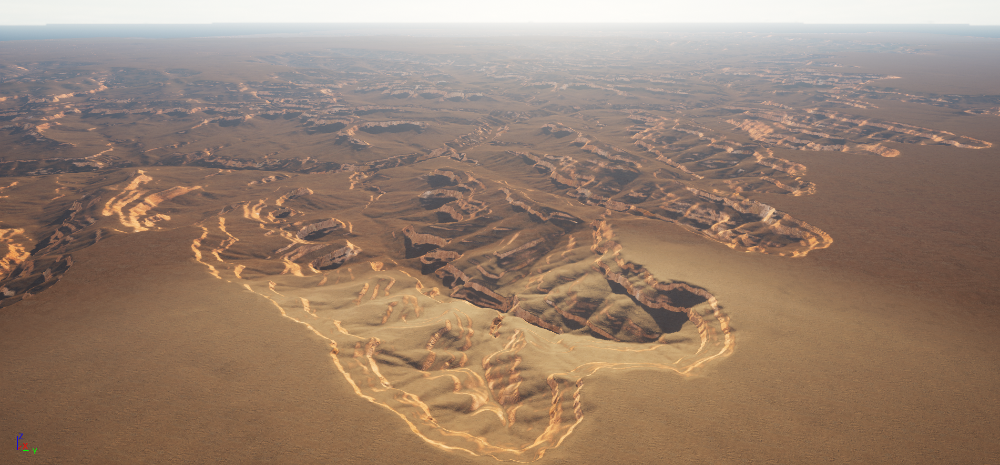

<div align="right">
  <details>
    <summary >🌐 Language</summary>
    <div>
      <div align="center">
        <a href="https://openaitx.github.io/view.html?user=manticorp&project=unrealheightmap&lang=en">English</a>
        | <a href="https://openaitx.github.io/view.html?user=manticorp&project=unrealheightmap&lang=zh-CN">简体中文</a>
        | <a href="https://openaitx.github.io/view.html?user=manticorp&project=unrealheightmap&lang=zh-TW">繁體中文</a>
        | <a href="https://openaitx.github.io/view.html?user=manticorp&project=unrealheightmap&lang=ja">日本語</a>
        | <a href="https://openaitx.github.io/view.html?user=manticorp&project=unrealheightmap&lang=ko">한국어</a>
        | <a href="https://openaitx.github.io/view.html?user=manticorp&project=unrealheightmap&lang=hi">हिन्दी</a>
        | <a href="https://openaitx.github.io/view.html?user=manticorp&project=unrealheightmap&lang=th">ไทย</a>
        | <a href="https://openaitx.github.io/view.html?user=manticorp&project=unrealheightmap&lang=fr">Français</a>
        | <a href="https://openaitx.github.io/view.html?user=manticorp&project=unrealheightmap&lang=de">Deutsch</a>
        | <a href="https://openaitx.github.io/view.html?user=manticorp&project=unrealheightmap&lang=es">Español</a>
        | <a href="https://openaitx.github.io/view.html?user=manticorp&project=unrealheightmap&lang=it">Italiano</a>
        | <a href="https://openaitx.github.io/view.html?user=manticorp&project=unrealheightmap&lang=ru">Русский</a>
        | <a href="https://openaitx.github.io/view.html?user=manticorp&project=unrealheightmap&lang=pt">Português</a>
        | <a href="https://openaitx.github.io/view.html?user=manticorp&project=unrealheightmap&lang=nl">Nederlands</a>
        | <a href="https://openaitx.github.io/view.html?user=manticorp&project=unrealheightmap&lang=pl">Polski</a>
        | <a href="https://openaitx.github.io/view.html?user=manticorp&project=unrealheightmap&lang=ar">العربية</a>
        | <a href="https://openaitx.github.io/view.html?user=manticorp&project=unrealheightmap&lang=fa">فارسی</a>
        | <a href="https://openaitx.github.io/view.html?user=manticorp&project=unrealheightmap&lang=tr">Türkçe</a>
        | <a href="https://openaitx.github.io/view.html?user=manticorp&project=unrealheightmap&lang=vi">Tiếng Việt</a>
        | <a href="https://openaitx.github.io/view.html?user=manticorp&project=unrealheightmap&lang=id">Bahasa Indonesia</a>
        | <a href="https://openaitx.github.io/view.html?user=manticorp&project=unrealheightmap&lang=as">অসমীয়া</
      </div>
    </div>
  </details>
</div>

# 16/32 Bit Grayscale PNG/EXR Heightmap Generator

A free, browser-based tool that turns real-world elevation data into high-quality heightmaps, texture maps and 3D models.

It makes 16-bit PNG or 16/32-bit EXR heightmaps for Unreal Engine 5, Godot / Terrain3D, Blender and Unity, plus STL files for 3D printing. Everything runs in your browser, with nothing to install.

🌐 **Live website:** [manticorp.github.io/unrealheightmap](https://manticorp.github.io/unrealheightmap/)
📖 **Documentation:** [manticorp.github.io/unrealheightmap/instructions.html](https://manticorp.github.io/unrealheightmap/instructions.html)

[](https://ko-fi.com/L4L212G6M7)

## ⚠️ Important Notice

The tool has started hitting the free tier limits of some map services, so parts of the site *may not work* until there's funding to raise those limits. If you find it useful, please consider [supporting the project](https://ko-fi.com/harrymustoeplayfair).

## ✨ Features

### Heightmaps

- **16-bit PNG, or 16/32-bit OpenEXR.** 65,536 height levels or more, where 8-bit gives only 256.
- **Two elevation sources:**
  - [AWS Terrain Tiles](https://registry.opendata.aws/terrain-tiles/) (the Mapzen data)
  - [Mapterhorn](https://mapterhorn.com): Copernicus GLO-30 worldwide, plus 0.25 to 10 m lidar for the USA (USGS 3DEP), the UK, most of Europe, Japan, New Zealand and more, at output zooms up to 18
- **Normalisation.** Off, Regular, or Smart (ignores outliers), with optional manual min/max heights.
- **Sizes.** Unreal Engine and power-of-two presets, or any custom size up to 8129 × 8129.
- **Tiled exports.** Split into tiles by size or count, with optional zip, edge padding and Unreal 5.7+ (`_x00_y00`) naming. For huge areas, tiles can be generated one at a time.
- **Unreal scale values.** The tool shows the XY and Z landscape scale that reproduces real-world heights.
- **Georeferencing.** EPSG:3857 world files (`.pgw` / `.wld`) and `.prj` files for QGIS and other GIS software.

### Texture maps and water

- **Normal map.** DirectX for Unreal, or OpenGL for Godot, Blender and Unity.
- **Masks.** Slope, curvature, and height-band masks that work as landscape layer weightmaps.
- **Water.** Flatten everything below a water level, and export a water mask.
- **Albedo.** A colour image from satellite, topographic and other map styles, aligned pixel for pixel with the heightmap.

### 3D

- **3D preview.** Orbit around the export area before downloading anything.
- **3D model export:**
  - **STL** for 3D printing: top surface only, or a watertight solid with a base of any thickness, sized in millimetres, with height exaggeration
  - **OBJ** and **GLB/glTF**, with UVs, for Blender and game engines

### Ease of use

- **Place search.** Find mountains, valleys and towns by name, or type coordinates.
- **Shareable links.** The URL holds your location and settings, so you can bookmark or share an exact export.
- **Paste coordinates.** Decimal and DMS formats both work.

## 🚀 Quick Start

1. Open [the generator](https://manticorp.github.io/unrealheightmap/).
2. Search for a place, drag the map, or paste coordinates.
3. Pick an **Elevation Data** source. Mapterhorn is the most detailed in most places.
4. Set the **Output Zoom** and **size**. The orange rectangle shows the export area.
5. Click **Generate Heightmap**.

The [documentation](https://manticorp.github.io/unrealheightmap/instructions.html) explains every setting. The [import guides](https://manticorp.github.io/unrealheightmap/guides.html) go step by step, with true real-world scale:

- [Unreal Engine 5](https://manticorp.github.io/unrealheightmap/guide-unreal.html): Z scale maths, tiled World Partition import, weightmap layers, water
- [Blender](https://manticorp.github.io/unrealheightmap/guide-blender.html): Displace modifier, Cycles adaptive subdivision, Geometry Nodes, BlenderGIS
- [Godot 4](https://manticorp.github.io/unrealheightmap/guide-godot.html): Terrain3D, HTerrain, plugin-free collision
- [Unity](https://manticorp.github.io/unrealheightmap/guide-unity.html): RAW conversion, Terrain sizing, splatmaps
- [QGIS, Gaea, World Machine, Houdini and image editors](https://manticorp.github.io/unrealheightmap/guide-other.html)
- [3D printing](https://manticorp.github.io/unrealheightmap/guide-3d-printing.html)

## 🎨 Examples

### Grand Canyon (64 km)

[Open this area in the tool](https://manticorp.github.io/unrealheightmap/#lat=36.18112&lng=-112.021&z=10&oz=14&w=8129&h=8129)



More on the [Examples page](https://manticorp.github.io/unrealheightmap/examples.html).

## 💻 Development

You'll need Node.js 18 or newer, and npm.

```bash
git clone https://github.com/manticorp/unrealheightmap.git
cd unrealheightmap
npm install
```

| Command | What it does |
| --- | --- |
| `npm run watch` | Development build, rebuilding on every change |
| `npm run build` | One-off development build |
| `npm run author` | Production build into `public/dist/` (commit this, because GitHub Pages serves it) |
| `npm test` | Unit tests (Jest) |

The site is static. Serve the repository root with any web server, for example `npx http-server .`, and open `index.html`.

### Project Structure

```
├── src/
│   ├── main.ts            # Entry point
│   ├── app.ts             # UI, map, settings and export orchestration
│   ├── processor.ts       # Web worker: stitching, normalisation, maps, meshes
│   ├── elevation.ts       # Elevation sources (AWS Terrain Tiles, Mapterhorn)
│   ├── derived-maps.ts    # Normal, slope, curvature, height bands, water
│   ├── mesh.ts            # Mesh building and STL / OBJ / GLB writers
│   ├── preview3d.ts       # three.js 3D preview (loaded on demand)
│   ├── place-search.ts    # Place search box (Photon geocoder)
│   ├── url-state.ts       # Shareable URL settings
│   ├── png.ts, exr*.ts    # PNG and OpenEXR encoding
│   ├── sass/              # Stylesheets
│   └── templates/         # Header and footer HTML
├── tests/                 # Jest unit tests
├── public/
│   ├── dist/              # Built JS and CSS (committed)
│   └── im/, examples/     # Images used by the docs
├── index.html             # The generator
├── instructions.html      # Documentation
├── guides.html, guide-*.html  # Import guides per program
├── examples.html          # Examples
└── rights.html            # Data sources and licences
```

### Technology

TypeScript, webpack, Leaflet, three.js, Comlink (web worker), UPNG.js and pako (PNG), JSZip, jQuery, Bulma and Sass.

## 🤝 Contributing

Issues and pull requests are welcome. Please run `npm test` and `npm run author` before opening a pull request, so the built files match the source.

## 📄 License

The code is MIT licensed. See [LICENSE](LICENSE).

Elevation data and map imagery come from third parties with their own terms. See the [License Info page](https://manticorp.github.io/unrealheightmap/rights.html):

- **Elevation:** [Mapterhorn](https://mapterhorn.com) (Copernicus GLO-30, USGS 3DEP, swisstopo and other open sources) and [AWS Terrain Tiles](https://registry.opendata.aws/terrain-tiles/) (Mapzen)
- **Place search:** [Photon](https://photon.komoot.io) by Komoot, using © OpenStreetMap contributors data

## 💖 Support

If you find this tool useful:

- ☕ [Buy me a coffee on Ko-fi](https://ko-fi.com/harrymustoeplayfair)
- ⭐ Star this repository
- 🐦 Share it with others who might find it useful

## 🙏 Acknowledgments

- [Mapterhorn](https://mapterhorn.com) and [Mapzen](https://www.mapzen.com/blog/elevation/) for open global elevation data
- The Unreal Engine, Godot and Blender communities for ideas and feedback
- Everyone who has contributed, reported bugs or supported the project

## 📞 Contact

- **Author:** Harry Mustoe-Playfair
- **Email:** harry.mustoeplayfair@gmail.com
- **GitHub:** [manticorp](https://github.com/manticorp)

---

Made with ❤️ for the Unreal Engine, 3D and game development community
